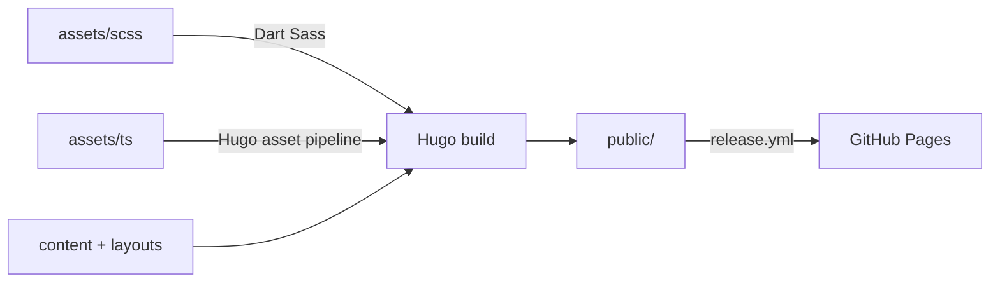

# 7. Deployment View

Static site on GitHub Pages: <https://tiliavir.github.io/feschtkaessle/>.
No server; all data stays in the browser (`localStorage`). Only exception: the optional
feedback endpoint, a PHP script at Alfahosting that files GitHub issues ([feedback](../feedback.md)).

`public/` and compiled CSS/JS in `static/` are build output and gitignored.

## Release

- Bump `version` in `package.json` (SemVer) and merge to `main`.
- `release.yml` sees a version without tag `vX.Y.Z`, runs the full check
  (`npm run build`), creates the GitHub Release and tag, and deploys `public/`.
- Never push tags by hand. To redeploy without a new version, run the
  Release workflow manually (Actions → Release → Run workflow).
- `<base href>` makes the subpath (`/feschtkaessle/`) work without patching HTML.

## Own deployment (fork)

Fill in your contact details in `content/impressum/_index.md` before
deploying publicly; the liability disclaimer is in
`content/haftungsausschluss/_index.md`.
